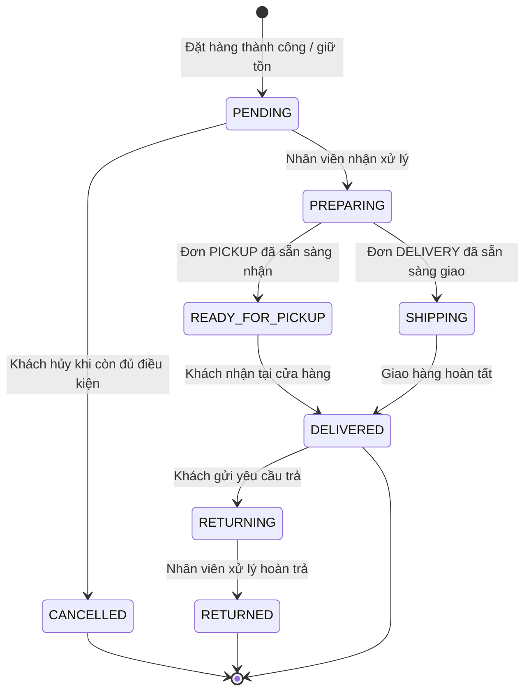

# Activity vòng đời đơn hàng

Điều kiện nghiệp vụ được kiểm tra trong service, không chỉ bởi sơ đồ:

- Đặt đơn dùng `Idempotency-Key`, kiểm tra giỏ/tồn và giữ tồn.
- Đơn có thanh toán online còn thiếu tiền không được chuyển sang `DELIVERED`.
- Hàng bán theo cân phải có `actualWeight` trước các chuyển trạng thái yêu cầu hoàn tất chuẩn bị.
- `PICKUP` dùng `READY_FOR_PICKUP`; đơn `DELIVERY` dùng `SHIPPING`.
- Endpoint status hiện chấp nhận `PREPARING`, `SHIPPING`, `READY_FOR_PICKUP`, `DELIVERED`, `RETURNED`; service kiểm tra trạng thái nguồn và điều kiện từng bước.
- `CANCELLED` và `RETURNING` được tạo bởi các hành động nghiệp vụ riêng, không phải giá trị cho phép trong DTO cập nhật status.
