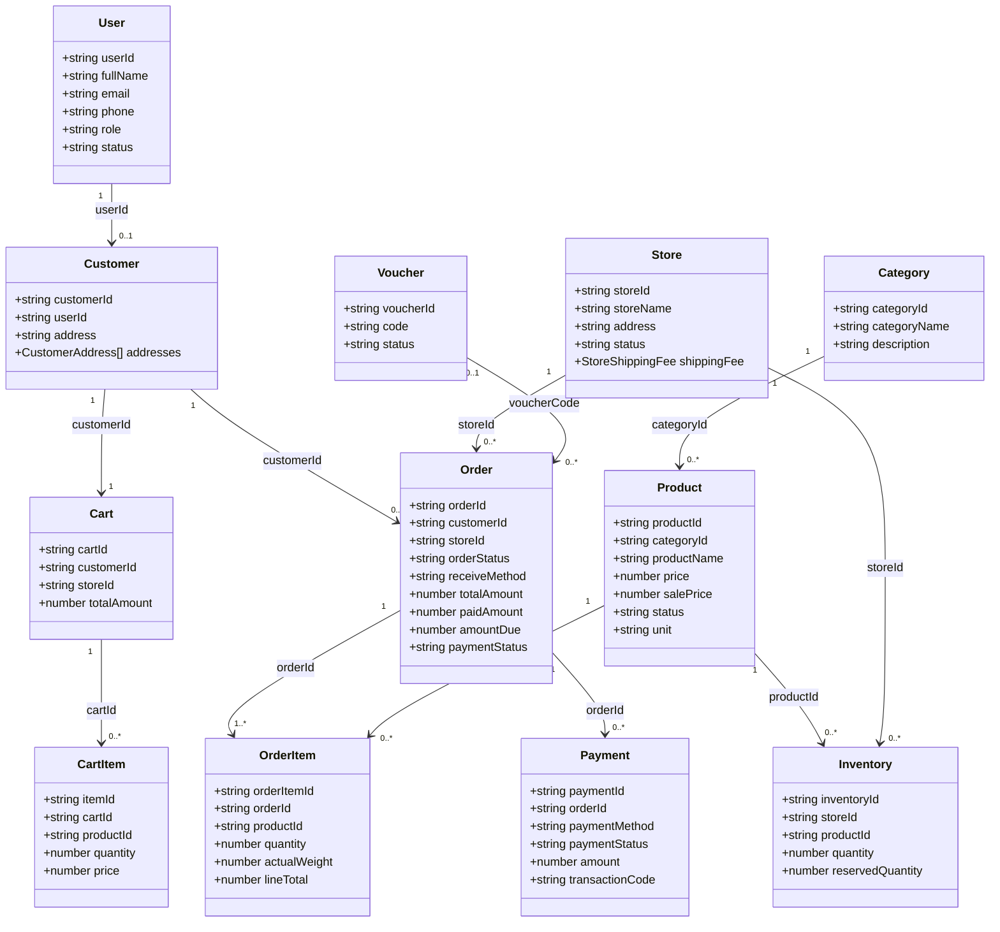

# Class diagram dữ liệu cốt lõi hiện tại

Đây là mô hình rút gọn từ Mongoose schemas đang có. Các mũi tên là liên kết bằng ID trong document; không khẳng định mọi liên kết được enforce bằng foreign key.

Sơ đồ không đưa vào các domain modules chưa đăng ký như review, delivery, membership points, reports, chat và AI configuration.
