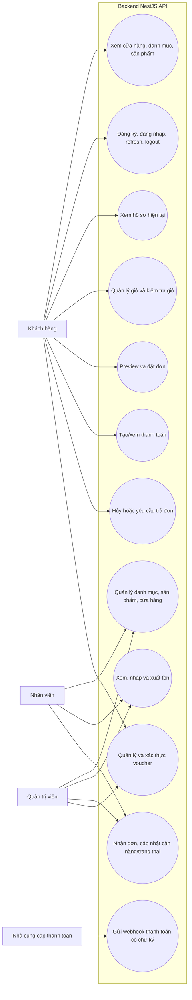

# Use cases đang được expose

Sơ đồ thể hiện khả năng hiện có ở API/backend và các route frontend được đăng ký. Không bao gồm các chức năng mới chỉ có trong bản thiết kế cũ.

Lưu ý: use case API không đồng nghĩa đã có màn hình tương ứng. Route `/admin` và `/staff` hiện chỉ mở trang placeholder; xem [API status](../../api/API.md).
